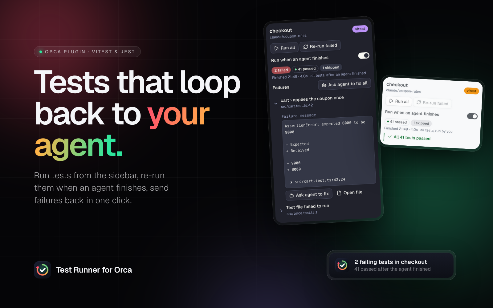
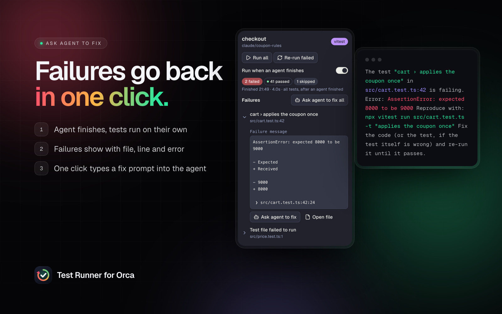
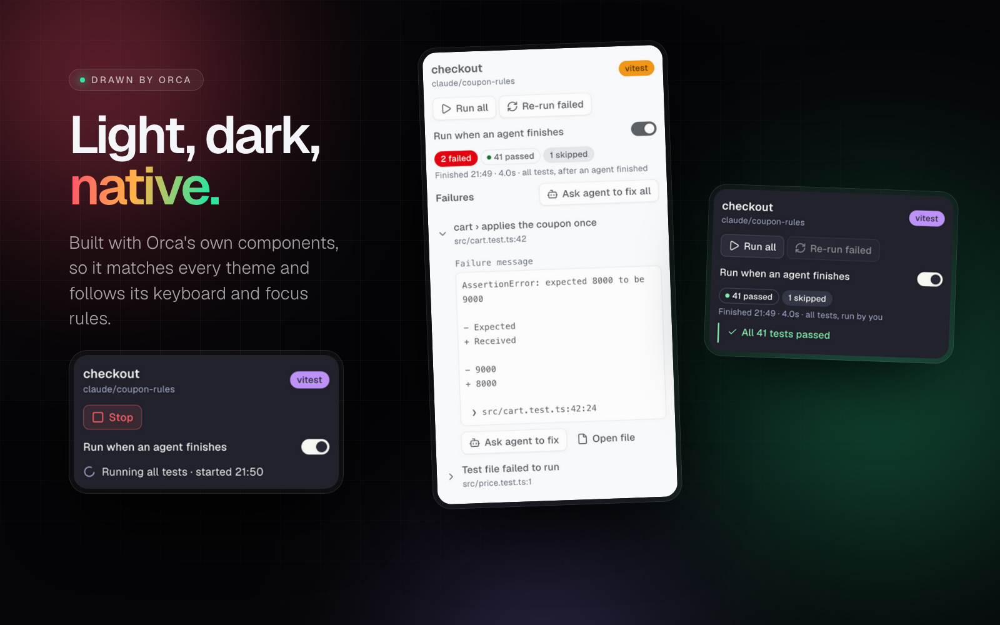

<p align="center">
  
</p>

<h1 align="center">Test Runner for Orca</h1>

<p align="center">
  <b>Tests that loop back to your agent.</b><br />
  Run Vitest or Jest from Orca's sidebar, re-run them when an agent finishes,<br />
  and send failures back to the agent to fix, in one click.
</p>

<p align="center">
  <a href="https://h00ns.github.io/test-runner-for-orca/"><b>Website</b></a> ·
  <a href="#install">Install</a> ·
  <a href="#how-it-works">How it works</a> ·
  <a href="#settings">Settings</a>
</p>

<p align="center">
  
  
  
  
</p>

<p align="center">
  
</p>

## Why

Coding agents change a lot of code between your glances. Test Runner keeps checking it for you:
when an agent finishes a turn that changed files, the workspace's tests run on their own, and any
failure goes straight back to that agent with everything it needs to reproduce and fix it.

## How it works

```
 Agent finishes ──▶ Tests run ──▶ Failures surface ──▶ Agent fixes ──┐
       ▲                                                            │
       └────────────────────────────────────────────────────────────┘
```

1. **Agent finishes.** Claude Code, Codex or any Orca agent ends a turn in a workspace.
2. **Tests run.** If `git status` changed since the last run, Vitest or Jest runs in that
   workspace. If nothing changed, nothing runs.
3. **Failures surface.** A desktop notification, and each failure in the panel with its file,
   line and a clean error (runner and Node stack frames trimmed).
4. **Agent fixes.** **Ask agent to fix** types the failure into the workspace's idle agent as a
   single-line prompt with a command to reproduce it. Then the loop starts again.

<p align="center">
  
</p>

## Features

| | |
| --- | --- |
| **Run all / Re-run failed / Stop** | Runs the focused workspace's suite, only the files that failed last time, or stops a long run. |
| **Run when an agent finishes** | Automatic runs after agent turns that changed files. A switch in the panel turns it off. |
| **Ask agent to fix** | Sends one failure, or all of them, to the workspace's idle agent. It never types into a busy agent or one waiting for permission. With no agent open, it starts the one you pick in settings. |
| **Open file** | Opens the failing test file in an editor tab. |
| **Notifications** | When an automatic run fails, and when tests pass again after failing. |
| **Zero config** | Finds Vitest or Jest in `package.json`, works with npm, pnpm and yarn, and finds `node` from Homebrew, Volta, mise or asdf. |

<p align="center">
  
</p>

## Install

**In Orca:** Settings → Plugins → search **Test Runner** → Install, then approve its access.

**From a terminal:**

```sh
orca plugin install h00ns/test-runner-for-orca
```

Then open the **Test Runner** tab in the right sidebar.

### Requirements

- Orca **1.4.260** or newer
- `vitest` or `jest` in the workspace root's `package.json`, installed in `node_modules`
- A local workspace. SSH and other remote workspaces are not supported yet.

## Settings

Settings → Plugins → Test Runner

| Setting | Default | |
| --- | --- | --- |
| Run tests when an agent finishes | on | Only when files changed since the last run |
| Notify after automatic runs | on | On failure, and when tests pass again |
| Agent to start | Claude Code | Used when the workspace has no agent to send a failure to |
| Run timeout (minutes) | 10 | A run past this is stopped |

## Access it asks for

Test Runner is a full-access (`trusted-worker`) plugin, because it starts your test runner as a
process. Orca asks you to approve this list once:

- Read workspaces, their terminals and agent status (to follow the focused workspace and agents finishing)
- Open files in an editor tab and focus terminals
- Type into agent terminals and start agents (only when you press **Ask agent to fix**)
- Show desktop notifications
- Keep its own storage (the last run per workspace) and settings

It sends nothing over the network and collects no data.

## Limitations

- Local workspaces only, for now
- Looks for the runner in the workspace root, so packages inside a monorepo are not found yet
- Vitest and Jest only. Both write the same JSON report, so other runners can be added.
- Orca can open a file but not jump to a line, so **Open file** opens the file at the top

## Develop

```sh
git clone https://github.com/h00ns/test-runner-for-orca
cd test-runner-for-orca
orca plugin test .          # unit, worker and panel tests; no Orca window needed
orca plugin check .         # renders the panel in each src/panel.check.ts scenario
orca plugin dev watch .     # loads this folder into Orca and streams its logs
```

| File | What it does |
| --- | --- |
| `src/protocol.ts` | The panel ↔ worker contract |
| `src/worker.ts` | Follows the workspace, runs tests, auto-runs, talks to agents |
| `src/runner/detect.ts` | Finds the runner, its entry file, and `node` |
| `src/runner/run.ts` | Starts a run with a JSON report, with timeout and cancel |
| `src/runner/report.ts` | Parses the Jest-compatible JSON report both runners write |
| `src/agent-prompt.ts` | Turns failures into a one-line agent prompt |
| `src/panel.tsx` | The sidebar panel, built with Orca's components |

## License

[MIT](LICENSE) © h00ns. A community plugin, not made by or affiliated with the Orca team.
