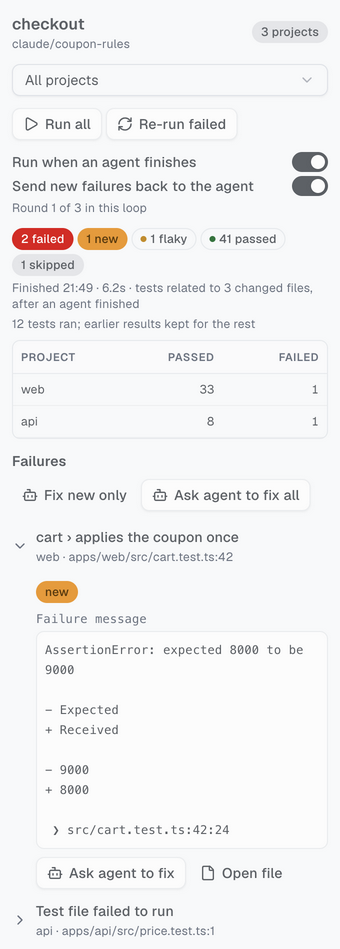

# Test Runner for Orca

Run your workspace's tests from [Orca](https://orca.dev)'s sidebar. When a coding agent finishes a
turn, Test Runner re-runs the tests related to what it changed, and sends any failure back to that
agent in one click.

[Orca directory](https://orca.dev/plugins/h00ns/test-runner-for-orca) · [Documentation](https://h00ns.github.io/test-runner-for-orca/) · [한국어 문서](https://h00ns.github.io/test-runner-for-orca/ko/)



**Contents:** [Quick start](#quick-start) · [Using the panel](#using-the-panel) ·
[Working with agents](#working-with-agents) · [How tests are run](#how-tests-are-run) ·
[Supported runners](#supported-runners) · [Configuration](#configuration) · [Settings](#settings) ·
[Troubleshooting](#troubleshooting) · [Access](#access) · [Limitations](#limitations)

## Quick start

1. **Install.** In Orca, open **Settings → Plugins**, search for **Test Runner**, install it and
   approve its access. Or run `orca plugin install h00ns/test-runner-for-orca`.
2. **Open the panel.** Open a workspace, then the **Test Runner** tab in the right sidebar. It
   finds your test runner on its own. Press **Run all** to check it works.
3. **Let an agent work.** When the agent finishes a turn that changed files, the related tests run
   by themselves. If one fails, press **Ask agent to fix**.

Most repositories need no setup. If the panel says *No test runner found*, or a run fails because
of how your tests are configured, see [Configuration](#configuration).

## Using the panel

| Control | What it does |
| --- | --- |
| **Run all** | Runs every test in the workspace (or in the project picked above it). |
| **Re-run failed** | Runs only the test files that failed last time. |
| **Stop** | Stops the run in progress, and what it started, such as Playwright's web server. |
| Project picker | Shown in a monorepo: pick one package to run only that one. |
| **Run when an agent finishes** | Turns automatic runs on or off. |
| **Send new failures back to the agent** | Turns the [automatic fix loop](#the-automatic-fix-loop) on or off. |
| **Ask agent to fix** | Sends one failure to the workspace's agent. |
| **Fix new only** / **Ask agent to fix all** | Sends only the new failures, or all of them. |
| **Open file** | Opens the failing test file in an editor tab. |

Each failure shows its test name, file and line, and the error with the runner's own stack frames
removed. Two badges mark what deserves attention:

- **new**: it was passing in the run before, so the latest change most likely broke it.
- **flaky**: it failed, then passed when run again. It is probably not the change's fault, and it
  is never sent to an agent.
- **server not running**: it could not connect to a server or database (connection refused).
  Start the app first, for example `pnpm dev`. No code change fixes it, so it is never sent to
  an agent.

The result also shows in Orca's **status bar** (for example *2 failed* or *41 passed*). Pressing
it runs the tests.

## Working with agents

### After an agent finishes

1. If the code is the same as at the last run, nothing runs. An agent that only answered a
   question costs nothing.
2. Otherwise, the files changed since the last run pick the tests. Vitest and Jest run only the
   tests that import them. Other runners run their whole suite when their folder changed. Browser
   tests (Playwright, Cypress) are left out unless you [opt them in](#configuration).
3. Failures are re-run once to separate flaky tests, then compared with the run before to mark
   new ones.
4. A notification tells you when tests start failing, and when they pass again.

The first automatic run in a workspace runs everything, because there is no earlier run to compare
with. So does a run after a file was deleted or renamed, or in a folder outside git.

A run that covers part of the suite keeps the earlier results for the rest. The panel then says,
for example, *12 tests ran; earlier results kept for the rest*.

### Sending failures to the agent

**Ask agent to fix** types the failure into the workspace's agent as a single line:

```text
The test "cart › applies the coupon once" in apps/web/src/cart.test.ts:42 is failing. Error: AssertionError: expected 8000 to be 9000 … Reproduce with: cd apps/web && npx vitest run src/cart.test.ts -t "applies the coupon once" Fix the code (or the test, if the test itself is wrong) and re-run it until it passes.
```

- It goes to an agent that is idle (finished or waiting for input).
- It never types into an agent that is working or waiting for permission. You get *The agent in
  this workspace is busy* instead.
- With no agent open, it starts the one chosen in [settings](#settings) (Claude Code by default),
  waits until it is ready, then types the failure.

### The automatic fix loop

Off by default. With **Send new failures back to the agent** on, each automatic run sends the
failures the agent caused back to the agent that just finished. It fixes them, finishes, and the
tests run again. After 3 rounds (configurable) it stops and tells you.

It only answers the agent that finished, skips a turn you interrupted, and never starts an agent
on its own. Failures that were there before the agent started are left alone.

## How tests are run

Test Runner does **not** run your `npm test` script. It starts each test runner directly, with the
options it needs to read the results:

| Runner | Command it runs |
| --- | --- |
| Vitest | `node node_modules/vitest/vitest.mjs run --reporter=json --outputFile=… --passWithNoTests --coverage.enabled=false` |
| Jest | `node node_modules/jest/bin/jest.js --json --outputFile=… --ci --passWithNoTests --forceExit --coverage=false` |
| Playwright | `node node_modules/@playwright/test/cli.js test --reporter=junit --pass-with-no-tests` |
| Cypress | `node node_modules/cypress/bin/cypress run --reporter junit` |
| Gradle | `./gradlew test --continue --console=plain` (or `gradle`) |
| Maven | `./mvnw test -fae -B` (or `mvn`) |
| pytest | `.venv/bin/python -m pytest --junitxml=… -o junit_family=xunit1 -q` (or `python3`) |

Why not the script:

- **It reads a report.** Failures come from a JSON or JUnit XML report, so the panel can show each
  failure's file, line and error. A script's console output can't be read reliably.
- **It runs part of the suite.** Related tests (`vitest related …`, `jest --findRelatedTests …`)
  and failed files only work when it passes the arguments itself.
- **It always finishes.** A script in watch mode would never end.
- **It works with any package manager**, npm, pnpm or yarn alike.

It looks at your `test` script only to tell which runner a package uses.

> **If your script passes options,** such as `"test": "vitest run --config vitest.unit.config.ts"`,
> those options are not used. Copy them into `args` in [`.orca-test-runner.json`](#configuration):
> `{ "projects": [{ "runner": "vitest", "args": ["--config", "vitest.unit.config.ts"] }] }`

Runs use your own `node` (from your PATH, Homebrew, Volta, mise or asdf), with colours off.
Coverage is off, so coverage thresholds don't fail a run of part of the suite. `CI` is not set,
so a Playwright config with `reuseExistingServer: !process.env.CI` still uses the dev server you
already run.

## Supported runners

| Runner | Found from | After an agent finishes | Re-run failed |
| --- | --- | --- | --- |
| Vitest | `vitest` in package.json, `vitest.config.*` | related tests | those files |
| Jest | `jest` in package.json, `jest.config.*` | related tests | those files |
| Playwright | `@playwright/test`, `playwright.config.*` | off by default | those files |
| Cypress | `cypress`, `cypress.config.*` | off by default | those files |
| Gradle | `build.gradle(.kts)`, `settings.gradle(.kts)` | whole suite | whole suite |
| Maven | `pom.xml` | whole suite | whole suite |
| pytest | `pytest.ini`, `[tool.pytest…]` in pyproject.toml, `conftest.py` | whole suite | those files |

The runner has to be installed (`node_modules`, or a Gradle/Maven wrapper, or a virtualenv).

**Monorepos.** Test Runner reads `pnpm-workspace.yaml` or the `workspaces` field of package.json,
and makes one project per package and runner. A root that only installs the runner for its
packages runs nothing itself. A root config that lists the packages (a Vitest workspace or
`projects`, Jest `projects`) runs them for them.

## Configuration

`.orca-test-runner.json` in the workspace root tells Test Runner exactly what to run. You need it
only when detection is not enough: options in your test script, an unusual layout, environment
variables, or browser tests you want run after each agent turn. Commit it, so your team shares it.

```json
{
  "$schema": "https://raw.githubusercontent.com/h00ns/test-runner-for-orca/main/schema/orca-test-runner.schema.json",
  "projects": [
    { "name": "web", "root": "apps/web", "runner": "vitest", "args": ["--config", "vitest.unit.config.ts"] },
    { "name": "api", "root": "services/api", "runner": "gradle" },
    { "name": "e2e", "root": "apps/web", "runner": "playwright", "autoRun": false }
  ]
}
```

| Key | Meaning |
| --- | --- |
| `projects` | What to run, instead of detecting it. Each entry: `root` (folder from the workspace root; default the root), `runner` (detected when left out), `name`, `args` (added to the [command](#how-tests-are-run)), `env`, `autoRun` (run after an agent finishes; default true, false for browser tests). |
| `ignore` | Folders to leave out of detection, when there is no `projects`. |
| `autoRunScope` | `related` or `all`: what runs after an agent finishes, in this workspace. |
| `env` | Environment variables for every project. They are also written into the reproduce command an agent gets. |

Don't put reporter, output file, watch or coverage options in `args`: Test Runner adds its own.
If the file has a mistake, the panel says what and where.

### Let your agent write it

Paste this into an agent in the workspace. It writes the file and checks each suite runs:

```text
Set up Test Runner for Orca in this repository by writing .orca-test-runner.json at the repository root.

1. Find every test suite: Vitest, Jest, Playwright, Cypress, Gradle, Maven or pytest. Look at every package.json (workspace packages too) and its test scripts, the runners' config files, build.gradle(.kts), pom.xml and pyproject.toml.
2. Add one entry to "projects" per suite, with "name", "root" (its folder relative to the repository root; leave it out for the root) and "runner" (vitest, jest, playwright, cypress, gradle, maven or pytest).
3. Add "args" only when the suite needs them, such as a config file, taken from how its test script runs it. Never add reporter, output file, watch or coverage options: Test Runner adds its own. Add "env" only for variables the tests need.
4. Set "autoRun": false for slow suites: browser tests (Playwright, Cypress) and tests that need a running server or database.
5. Start the file with "$schema": "https://raw.githubusercontent.com/h00ns/test-runner-for-orca/main/schema/orca-test-runner.schema.json" and keep it valid JSON, without comments.
6. Run each suite once with its runner and those args to check they work. Then tell me what you set up, and anything you left out and why.
```

The panel reads the file the next time it opens.

## Settings

**Settings → Plugins → Test Runner**

| Setting | Default |
| --- | --- |
| Run tests when an agent finishes | on |
| What runs after an agent finishes | related tests |
| Re-run failures once to catch flaky tests | on |
| Send new failures back to the agent automatically | off |
| Rounds before automatic sending stops | 3 |
| Notify after automatic runs | on |
| Agent to start, when you ask for a fix and none is open | Claude Code |
| Timeout per project | 10 minutes |

## Troubleshooting

**"No test runner found"**
- Install dependencies first (`npm install`, `pnpm install`…): the runner must be in `node_modules`.
- The runner must be named in a package.json (`vitest`, `jest`…) or have its config file. For
  anything else, add [`.orca-test-runner.json`](#configuration).

**"web: vitest did not finish" with the runner's output**
- The runner started but failed before reporting. The output under it says why: often a config
  file, an alias or an environment variable your test script sets. Move those into `args` or
  `env` in [`.orca-test-runner.json`](#configuration).
- *Cannot find native binding* (rolldown, esbuild, swc): update Test Runner to 0.2.1 or later.
- *exited with code 1 although no test failed*: the runner failed after the tests, for example on
  an unhandled error. The output shows it.

**Tests fail with "server not running" (connection refused)**
- The tests need your app, an API or a database running, and it isn't. Start it (for example
  `pnpm dev`) and run them again, or give Playwright a `webServer` in its config so it starts
  the app itself.

**Tests don't run after the agent finishes**
- Check **Run when an agent finishes** is on.
- They run only when files changed. *No tests ran* after a turn means no test imports the changed
  files.
- Browser tests are left out by default.

**Playwright never finishes.** Playwright 1.49 hangs on Node 24, also outside Orca. Update it.

**The panel says "Remote workspace".** SSH workspaces are not supported yet.

**Logs.** `orca plugin logs h00ns.test-runner` shows what Test Runner did and why. Include them
when you [report a problem](https://github.com/h00ns/test-runner-for-orca/issues/new/choose).

## Access

Test Runner is a full-access (`trusted-worker`) plugin, because it starts your test runners as
processes. Orca asks you to approve once that it may:

- read workspaces, their terminals and agent status
- open files in an editor tab and focus terminals
- type into agent terminals and start agents: when you press a button, or with the fix loop on
- show notifications and a status bar item
- keep its own storage (the last results per workspace) and settings

It makes no network requests and collects no data.

## Limitations

- Local workspaces only. SSH workspaces need a way for plugins to run processes on the remote
  host, which Orca does not offer yet.
- **Open file** opens the file at the top: Orca's API cannot open a file at a line yet.
- Only Vitest and Jest pick related tests. Other runners run their whole suite.

## Development

```sh
git clone https://github.com/h00ns/test-runner-for-orca
cd test-runner-for-orca
orca plugin dev watch .     # load into Orca and stream logs
orca plugin test .          # all tests (worker and panel tests need the Orca CLI)
node --test src/agent-prompt.test.ts src/workspace-signature.test.ts src/runner/*.test.ts   # pure tests, plain Node 24
orca plugin check .         # render the panel in each src/panel.check.ts scenario
```

| Path | |
| --- | --- |
| `src/worker.ts` | Follows the workspace, plans and runs, auto-run, the fix loop, status bar |
| `src/runner/projects.ts` | Finds projects: config file, monorepo packages, runners |
| `src/runner/run.ts` | The command for each runner and mode, the process, the report |
| `src/runner/report.ts`, `junit.ts` | Jest JSON and JUnit XML reports |
| `src/agent-prompt.ts` | The one-line prompt and reproduce command per runner |
| `src/panel.tsx`, `src/i18n.ts` | The panel, in English and Korean |

Releases: bump `version` in `orca-plugin.json`, add a [CHANGELOG](CHANGELOG.md) entry, then push a
`vX.Y.Z` tag. The Orca directory picks up new tags on its own.

## License

[MIT](LICENSE). A community plugin, not made by the Orca team.
